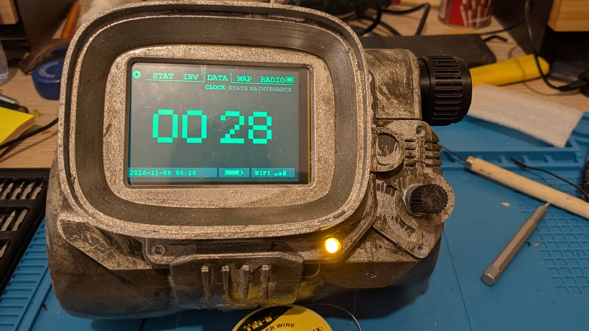

# pip-boy-esp32

A Pip-Boy style clock for an ESP32-S3 driving a
[Waveshare 3.5inch RPi LCD (G)](https://www.waveshare.com/wiki/3.5inch_RPi_LCD_(G)).



- Large block-digit clock, synced over NTP, with date and Wi-Fi signal in the status bar
- Green CRT look: scanlines and a rolling refresh band
- On-device Wi-Fi setup: network scan, on-screen keyboard; credentials saved to flash once they work

## Hardware

- **Microcontroller:** ESP32-S3 development board
- **Screen:** [Waveshare 3.5inch RPi LCD (G)](https://www.waveshare.com/wiki/3.5inch_RPi_LCD_(G)),
  a 480x320 ST7796 display with an XPT2046 resistive touch controller, connected over SPI
- **Case:** 3D printed from the
  [Raspberry Pi Pipboy 3000 MkVI](https://cults3d.com/en/3d-model/gadget/raspberry-pi-pipboy-3000-mkvi)
  model on Cults3D. Credit for the case design goes to its author.

### Wiring

| Signal    | ESP32-S3 pin |
|-----------|--------------|
| SCLK      | 12           |
| MOSI      | 13           |
| MISO      | 4 (touch only) |
| LCD CS    | 14           |
| LCD DC    | 17           |
| LCD RST   | 18           |
| Backlight | 5            |
| Touch CS  | 2            |
| Touch IRQ | 9            |

## Setup

1. Install the **esp32** board package (Espressif) and these libraries:
   - [TFT_eSPI](https://github.com/Bodmer/TFT_eSPI)
   - [XPT2046_Touchscreen](https://github.com/PaulStoffregen/XPT2046_Touchscreen)
2. Configure TFT_eSPI for this display: copy
   `extras/TFT_eSPI/Setup_Waveshare35G_ESP32S3.h` into the library's `User_Setups/`
   folder and select it in `User_Setup_Select.h`:
   ```cpp
   #include <User_Setups/Setup_Waveshare35G_ESP32S3.h>
   ```
   (comment out any other active setup include).
3. Adjust `pip-boy-esp32/config.h` if needed: timezone, NTP server, touch pins and calibration.
4. Build and flash, e.g. with arduino-cli:
   ```sh
   arduino-cli compile --fqbn esp32:esp32:esp32s3 pip-boy-esp32
   arduino-cli upload  --fqbn esp32:esp32:esp32s3 -p /dev/ttyACM0 pip-boy-esp32
   ```
   or open `pip-boy-esp32/pip-boy-esp32.ino` in the Arduino IDE with board *ESP32S3 Dev Module*.

On first boot the device asks you to pick a Wi-Fi network. On later boots it offers to
reconnect to the saved one.

## Touch calibration

Set `TOUCH_DEBUG` to `1` in `config.h`, open the serial monitor at 115200 baud and tap
the screen corners. Use the raw values to set `TOUCH_X/Y_MIN/MAX` and `TOUCH_FLIP_X/Y`,
then set `TOUCH_DEBUG` back to `0`: the log shows tap positions, which reveal typed passwords.

## Code layout

| File | Contents |
|------|----------|
| `pip-boy-esp32.ino` | Includes, global state, `setup()` / `loop()` |
| `config.h` | User settings |
| `ui.h` | Screen layout constants, types, glyph and keyboard tables |
| `crt.ino` | Strip renderer, palette, scanlines and refresh band |
| `screens.ino` | Drawing of the clock and setup screens |
| `clock.ino` | Clock updates from local time |
| `touch.ino` | Touch input |
| `wifi_setup.ino` | Interactive Wi-Fi setup |

## Credits

- Case: [Raspberry Pi Pipboy 3000 MkVI](https://cults3d.com/en/3d-model/gadget/raspberry-pi-pipboy-3000-mkvi) on Cults3D.
  The model is not part of this repository and is subject to its own license.

## License

MIT, see [LICENSE](LICENSE).
